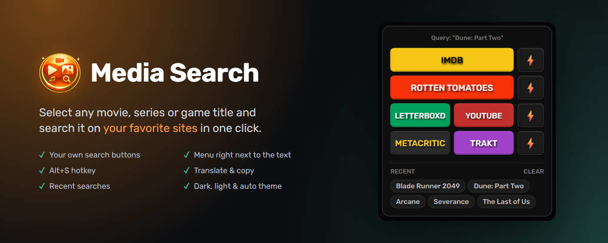
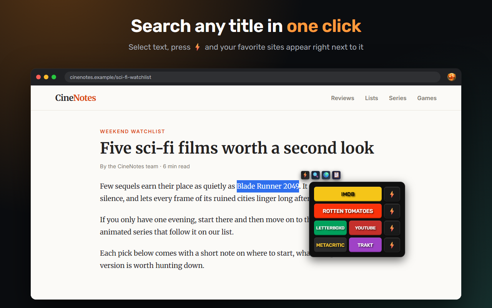
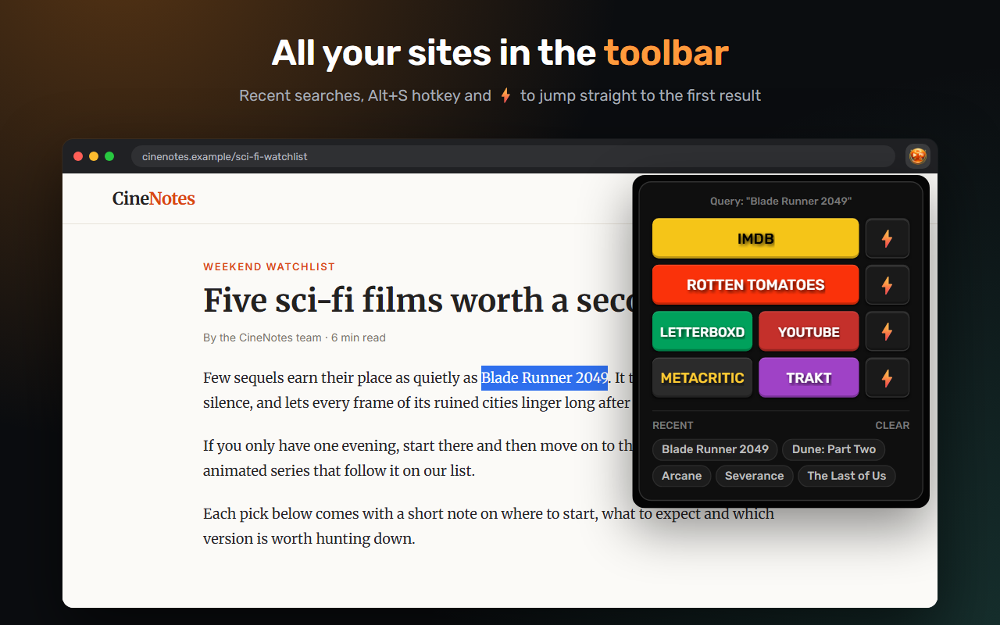
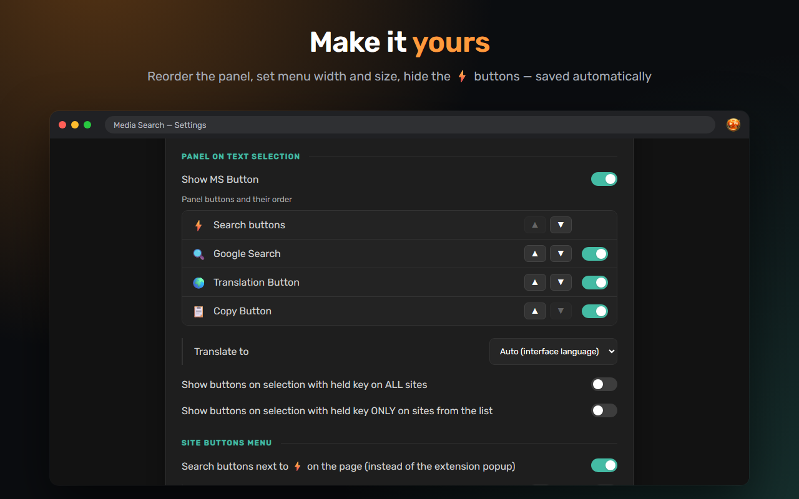
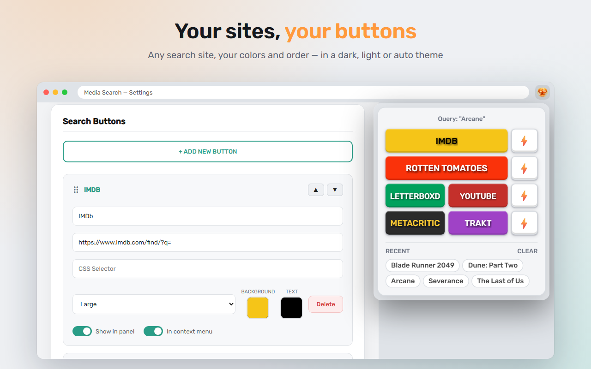
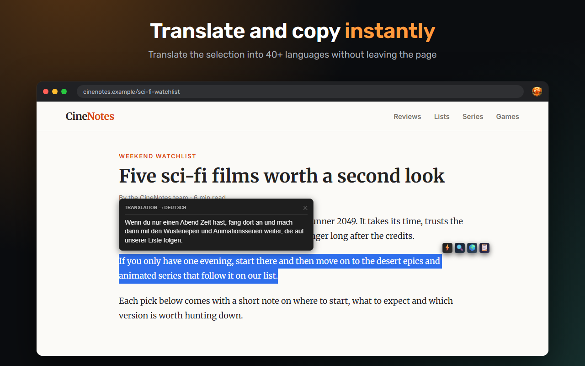

  

  <b>English</b> · <a href="README.ru.md">Русский</a> · <a href="README.uk.md">Українська</a>

# Media Search

A Chrome extension that searches any movie, series or game title on your favorite sites in one click.

Select a title on any page and press ⚡: your own search buttons appear right next to the text. One more click and the search opens on IMDb, Rotten Tomatoes, Letterboxd, YouTube or any other site you add.

## Screenshots

| | |
|---|---|
|  |  |
| **Search any title in one click.** The menu opens right next to the selected text. | **The popup in the toolbar.** Recent searches, the Alt+S hotkey and ⚡ to jump to the first result. |
|  |  |
| **Make it yours.** Reorder the panel, set the menu width and size, hide the ⚡ buttons. | **Your sites, your buttons.** Any search site, your colors and order, in a dark, light or auto theme. |
|  | |
| **Translate and copy.** Translate the selection into 40+ languages without leaving the page. | |

## Features

**Search**
- Unlimited custom search buttons: name, search URL, background and text color, large or mini size
- Search menu right next to the selected text, or the classic popup in the toolbar
- ⚡ next to each row opens the first search result directly (optional CSS selector)
- Search from the right-click menu
- Alt+S hotkey (can be changed in `chrome://extensions/shortcuts`)
- Keyboard control in the menu: arrows / Tab to move, Enter to open, 1–9 to open a button, Esc to close

**Selection panel**
- Four quick buttons: ⚡ search, 🔍 Google, 🌍 translate, 📋 copy
- Change their order and switch off the ones you don't need
- Translation into 44 languages, or automatically into the interface language
- Show the panel only while a key is held — on all sites or only on sites from your list

**Look and feel**
- Dark, light and auto theme
- Menu width (200–400 px) and size (60–100 %)
- Optional site icons and optional ⚡ buttons on the right
- Long names shrink to fit before they get "…"
- Your own font, button font size and logo

**Convenience**
- Recent searches in the popup (optional, last 15)
- Hide a button without deleting it — separately for the panel and the context menu
- Drag and drop to reorder buttons
- Settings are saved automatically
- Backup and restore of all settings
- Interface in 8 languages: English, Ukrainian, Russian, German, French, Spanish, Italian, Polish

## Installation

**Chrome Web Store** — search for "Media Search".

**Manually (developer mode)**
1. Download the latest release and unpack it.
2. Open `chrome://extensions` and turn on **Developer mode**.
3. Click **Load unpacked** and select the unpacked folder.

Requires Chrome 127 or newer.

## How to add a search site

1. Open any site, search for any word and copy the address of the results page.
2. Remove the word from the address — what is left is the **search URL**, for example `https://www.google.com/search?q=`.
   If the word sits in the middle of the address, put `{searchTerms}` in its place: `https://letterboxd.com/search/{searchTerms}/`.
3. Optional: a **CSS selector** for ⚡ — the link of the first result, e.g. `a[href*="/film/"]`.

The full guide with examples is built into the settings page.

## Privacy

No accounts, no tracking, no ads.

- Settings and search history are stored only in your browser (`chrome.storage.local`).
- The selected text is sent only where you send it: to the search site you click, or to Google Translate when you press 🌍.
- Site icons come from Chrome's own favicon cache — no requests to outside services.

## Permissions

| Permission | Why |
|---|---|
| `contextMenus` | Search items in the right-click menu |
| `scripting`, `activeTab` | Read the selected text when you open the popup or press the hotkey |
| `storage` | Save your buttons, settings and (optional) search history |
| `favicon` | Show site icons on the buttons (optional) |
| `translate.googleapis.com` | Translate the selection when you press 🌍 |
| Content script on http/https pages | Show the panel next to the text you select |

## Changelog

See [CHANGELOG.md](CHANGELOG.md).

# Русский

  

  <a href="README.md">English</a> · <b>Русский</b> · <a href="README.uk.md">Українська</a>

# Media Search

Расширение для Chrome, которое ищет любой фильм, сериал или игру на ваших любимых сайтах в один клик.

Выделите название на любой странице и нажмите ⚡ — ваши кнопки поиска появятся прямо возле текста. Ещё один клик — и поиск откроется на IMDb, Rotten Tomatoes, Letterboxd, YouTube или любом другом сайте, который вы добавили.

## Скриншоты

| | |
|---|---|
|  |  |
| **Поиск в один клик.** Меню открывается прямо возле выделенного текста. | **Окно на панели браузера.** История запросов, горячая клавиша Alt+S и ⚡ для перехода к первому результату. |
|  |  |
| **Под себя.** Порядок кнопок панели, ширина и размер меню, скрытие кнопок ⚡. | **Ваши сайты — ваши кнопки.** Любой сайт поиска, свои цвета и порядок, тёмная, светлая или авто-тема. |
|  | |
| **Перевод и копирование.** Перевод выделенного на 40+ языков, не уходя со страницы. | |

## Возможности

**Поиск**
- Сколько угодно своих кнопок поиска: название, адрес поиска, цвет фона и текста, большой или мини-размер
- Меню поиска прямо возле выделенного текста или классическое окно на панели браузера
- ⚡ возле каждого ряда сразу открывает первый результат поиска (необязательный CSS-селектор)
- Поиск через контекстное меню
- Горячая клавиша Alt+S (меняется в `chrome://extensions/shortcuts`)
- Управление меню с клавиатуры: стрелки / Tab — выбор, Enter — открыть, 1–9 — открыть кнопку, Esc — закрыть

**Панель при выделении**
- Четыре быстрые кнопки: ⚡ поиск, 🔍 Google, 🌍 перевод, 📋 копирование
- Можно менять их порядок и выключать ненужные
- Перевод на 44 языка или автоматически на язык интерфейса
- Показ панели только с зажатой клавишей — на всех сайтах или только на сайтах из списка

**Внешний вид**
- Тёмная, светлая и автоматическая тема
- Ширина меню (200–400 px) и размер (60–100 %)
- Значки сайтов и кнопки ⚡ справа — по желанию
- Длинные названия сначала уменьшаются, и только потом обрезаются «…»
- Свой шрифт, размер шрифта кнопок и логотип

**Удобство**
- История запросов в окне расширения (по желанию, последние 15)
- Кнопку можно скрыть, не удаляя, — отдельно для панели и контекстного меню
- Перетаскивание для изменения порядка кнопок
- Настройки сохраняются автоматически
- Резервная копия и восстановление всех настроек
- Интерфейс на 8 языках: русский, английский, украинский, немецкий, французский, испанский, итальянский, польский

## Установка

**Chrome Web Store** — найдите «Media Search».

**Вручную (режим разработчика)**
1. Скачайте последний релиз и распакуйте его.
2. Откройте `chrome://extensions` и включите **Режим разработчика**.
3. Нажмите **Загрузить распакованное расширение** и выберите распакованную папку.

Нужен Chrome 127 или новее.

## Как добавить сайт поиска

1. Откройте любой сайт, найдите на нём любое слово и скопируйте адрес страницы результатов.
2. Удалите это слово из адреса — то, что осталось, и есть **адрес поиска**, например `https://www.google.com/search?q=`.
   Если слово стоит в середине адреса, поставьте на его место `{searchTerms}`: `https://letterboxd.com/search/{searchTerms}/`.
3. По желанию: **CSS-селектор** для ⚡ — ссылка первого результата, например `a[href*="/film/"]`.

Полная инструкция с примерами есть прямо на странице настроек.

## Конфиденциальность

Без аккаунтов, слежки и рекламы.

- Настройки и история запросов хранятся только в вашем браузере (`chrome.storage.local`).
- Выделенный текст отправляется только туда, куда вы сами его отправляете: на выбранный сайт поиска или в Google Переводчик, когда вы нажимаете 🌍.
- Значки сайтов берутся из кэша самого Chrome — никаких запросов к внешним сервисам.

## Разрешения

| Разрешение | Зачем |
|---|---|
| `contextMenus` | Пункты поиска в меню правой кнопки мыши |
| `scripting`, `activeTab` | Прочитать выделенный текст, когда вы открываете окно расширения или нажимаете горячую клавишу |
| `storage` | Хранить ваши кнопки, настройки и (по желанию) историю запросов |
| `favicon` | Значки сайтов на кнопках (по желанию) |
| `translate.googleapis.com` | Перевод выделенного по нажатию 🌍 |
| Скрипт на страницах http/https | Показать панель возле выделенного текста |

## Список изменений

См. [CHANGELOG.ru.md](CHANGELOG.ru.md).

# Українська

  

  <a href="README.md">English</a> · <a href="README.ru.md">Русский</a> · <b>Українська</b>

# Media Search

Розширення для Chrome, яке шукає будь-який фільм, серіал чи гру на ваших улюблених сайтах в один клік.

Виділіть назву на будь-якій сторінці й натисніть ⚡ — ваші кнопки пошуку з'являться просто біля тексту. Ще один клік — і пошук відкриється на IMDb, Rotten Tomatoes, Letterboxd, YouTube або будь-якому іншому сайті, який ви додали.

## Знімки екрана

| | |
|---|---|
|  |  |
| **Пошук в один клік.** Меню відкривається просто біля виділеного тексту. | **Вікно на панелі браузера.** Історія запитів, гаряча клавіша Alt+S і ⚡ для переходу до першого результату. |
|  |  |
| **Під себе.** Порядок кнопок панелі, ширина й розмір меню, приховування кнопок ⚡. | **Ваші сайти — ваші кнопки.** Будь-який сайт пошуку, свої кольори й порядок, темна, світла або авто-тема. |
|  | |
| **Переклад і копіювання.** Переклад виділеного на 40+ мов, не залишаючи сторінку. | |

## Можливості

**Пошук**
- Скільки завгодно власних кнопок пошуку: назва, адреса пошуку, колір фону й тексту, великий або міні-розмір
- Меню пошуку просто біля виділеного тексту або класичне вікно на панелі браузера
- ⚡ біля кожного ряду одразу відкриває перший результат пошуку (необов'язковий CSS-селектор)
- Пошук через контекстне меню
- Гаряча клавіша Alt+S (змінюється в `chrome://extensions/shortcuts`)
- Керування меню з клавіатури: стрілки / Tab — вибір, Enter — відкрити, 1–9 — відкрити кнопку, Esc — закрити

**Панель при виділенні**
- Чотири швидкі кнопки: ⚡ пошук, 🔍 Google, 🌍 переклад, 📋 копіювання
- Можна змінювати їх порядок і вимикати непотрібні
- Переклад на 44 мови або автоматично на мову інтерфейсу
- Показ панелі лише із затиснутою клавішею — на всіх сайтах або тільки на сайтах зі списку

**Вигляд**
- Темна, світла та автоматична тема
- Ширина меню (200–400 px) і розмір (60–100 %)
- Значки сайтів і кнопки ⚡ праворуч — за бажанням
- Довгі назви спочатку зменшуються, і лише потім обрізаються «…»
- Власний шрифт, розмір шрифту кнопок і логотип

**Зручність**
- Історія запитів у вікні розширення (за бажанням, останні 15)
- Кнопку можна приховати, не видаляючи, — окремо для панелі та контекстного меню
- Перетягування для зміни порядку кнопок
- Налаштування зберігаються автоматично
- Резервна копія та відновлення всіх налаштувань
- Інтерфейс 8 мовами: українська, англійська, російська, німецька, французька, іспанська, італійська, польська

## Встановлення

**Chrome Web Store** — знайдіть «Media Search».

**Вручну (режим розробника)**
1. Завантажте останній реліз і розпакуйте його.
2. Відкрийте `chrome://extensions` і ввімкніть **Режим розробника**.
3. Натисніть **Завантажити розпаковане розширення** й виберіть розпаковану папку.

Потрібен Chrome 127 або новіший.

## Як додати сайт пошуку

1. Відкрийте будь-який сайт, знайдіть на ньому будь-яке слово й скопіюйте адресу сторінки результатів.
2. Видаліть це слово з адреси — те, що залишилося, і є **адреса пошуку**, наприклад `https://www.google.com/search?q=`.
   Якщо слово стоїть посередині адреси, поставте на його місце `{searchTerms}`: `https://letterboxd.com/search/{searchTerms}/`.
3. За бажанням: **CSS-селектор** для ⚡ — посилання першого результату, наприклад `a[href*="/film/"]`.

Повна інструкція з прикладами є просто на сторінці налаштувань.

## Конфіденційність

Без акаунтів, стеження та реклами.

- Налаштування й історія запитів зберігаються тільки у вашому браузері (`chrome.storage.local`).
- Виділений текст надсилається лише туди, куди ви самі його надсилаєте: на обраний сайт пошуку або в Google Перекладач, коли ви натискаєте 🌍.
- Значки сайтів беруться з кешу самого Chrome — жодних запитів до зовнішніх сервісів.

## Дозволи

| Дозвіл | Навіщо |
|---|---|
| `contextMenus` | Пункти пошуку в меню правої кнопки миші |
| `scripting`, `activeTab` | Прочитати виділений текст, коли ви відкриваєте вікно розширення або натискаєте гарячу клавішу |
| `storage` | Зберігати ваші кнопки, налаштування та (за бажанням) історію запитів |
| `favicon` | Значки сайтів на кнопках (за бажанням) |
| `translate.googleapis.com` | Переклад виділеного після натискання 🌍 |
| Скрипт на сторінках http/https | Показати панель біля виділеного тексту |

## Список змін

Див. [CHANGELOG.uk.md](CHANGELOG.uk.md).
