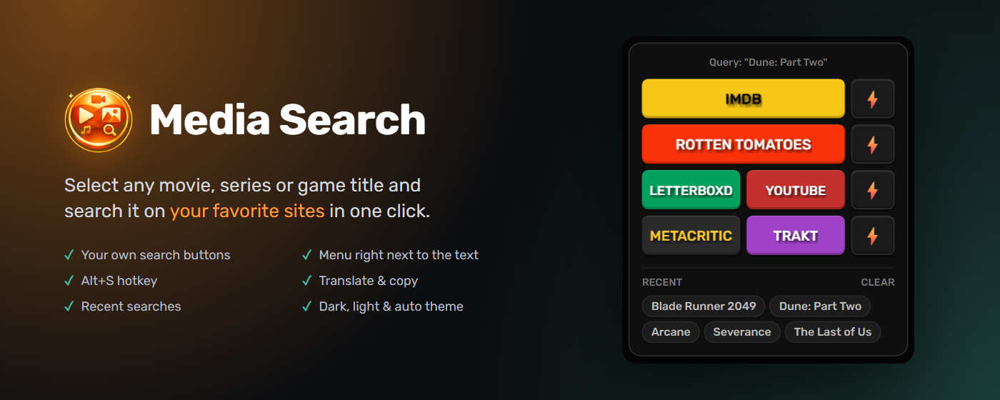
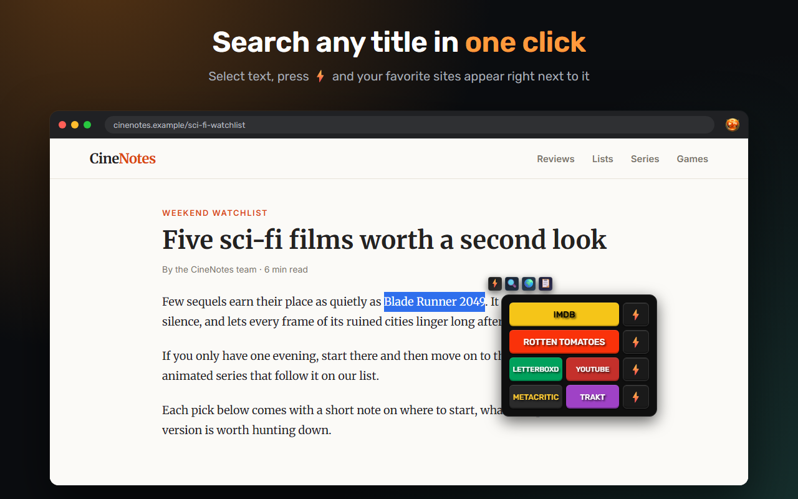
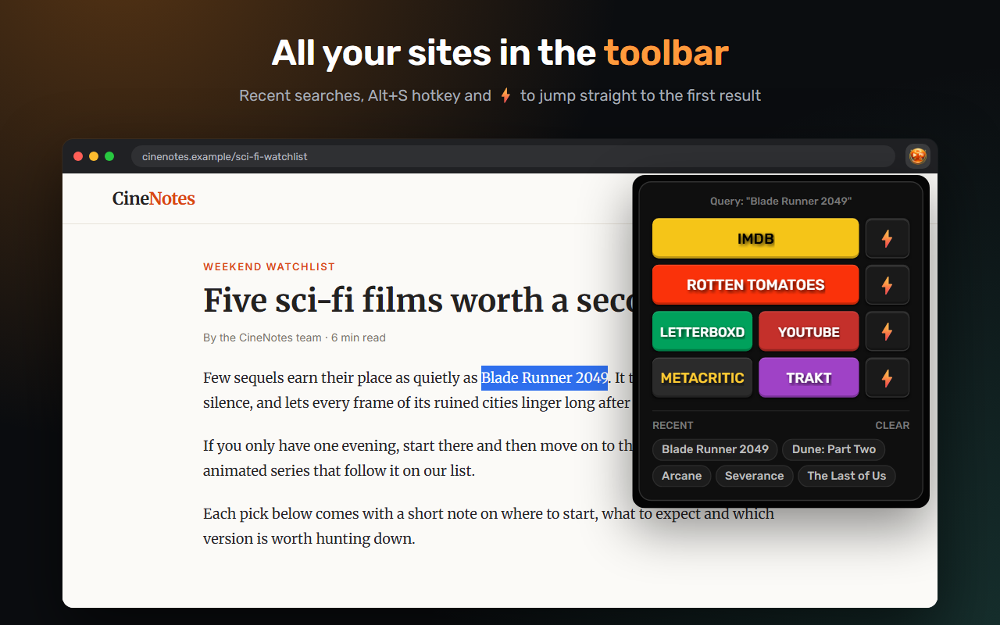
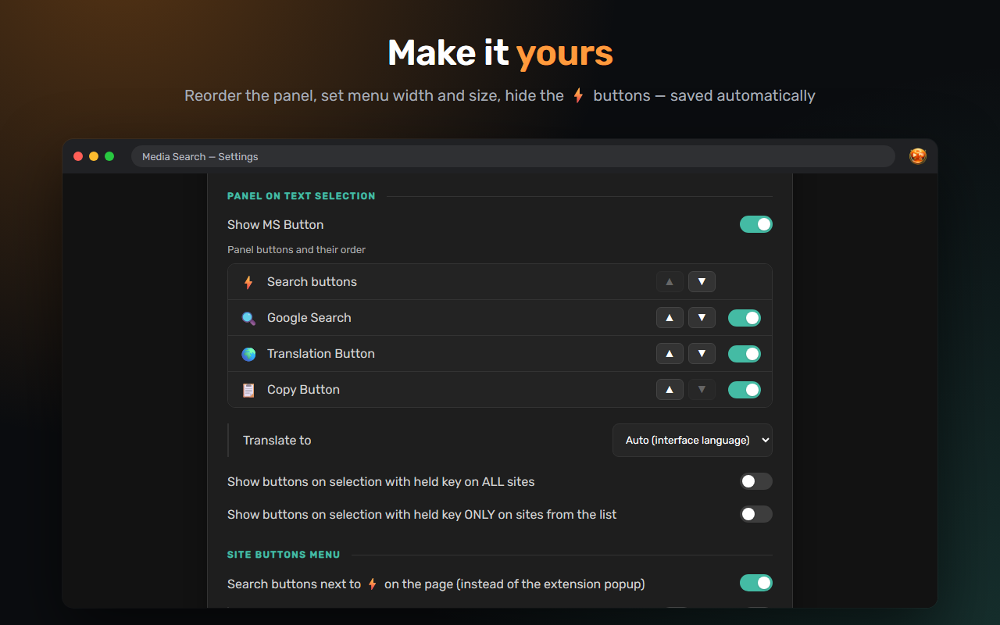
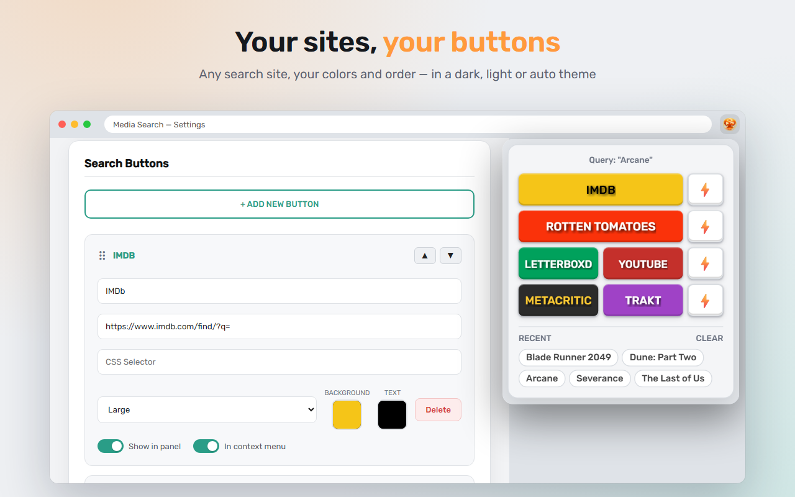
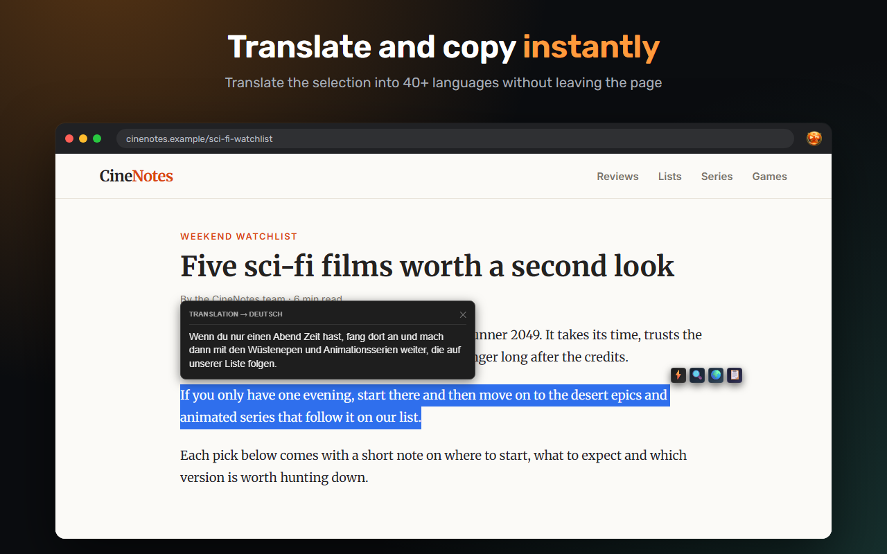

  

  <a href="README.md">English</a> · <b>Русский</b> · <a href="README.uk.md">Українська</a>

# Media Search

Расширение для Chrome, которое ищет любой фильм, сериал или игру на ваших любимых сайтах в один клик.

Выделите название на любой странице и нажмите ⚡ — ваши кнопки поиска появятся прямо возле текста. Ещё один клик — и поиск откроется на IMDb, Rotten Tomatoes, Letterboxd, YouTube или любом другом сайте, который вы добавили.

## Скриншоты

| | |
|---|---|
|  |  |
| **Поиск в один клик.** Меню открывается прямо возле выделенного текста. | **Окно на панели браузера.** История запросов, горячая клавиша Alt+S и ⚡ для перехода к первому результату. |
|  |  |
| **Под себя.** Порядок кнопок панели, ширина и размер меню, скрытие кнопок ⚡. | **Ваши сайты — ваши кнопки.** Любой сайт поиска, свои цвета и порядок, тёмная, светлая или авто-тема. |
|  | |
| **Перевод и копирование.** Перевод выделенного на 40+ языков, не уходя со страницы. | |

## Возможности

**Поиск**
- Сколько угодно своих кнопок поиска: название, адрес поиска, цвет фона и текста, большой или мини-размер
- Меню поиска прямо возле выделенного текста или классическое окно на панели браузера
- ⚡ возле каждого ряда сразу открывает первый результат поиска (необязательный CSS-селектор)
- Поиск через контекстное меню
- Горячая клавиша Alt+S (меняется в `chrome://extensions/shortcuts`)
- Управление меню с клавиатуры: стрелки / Tab — выбор, Enter — открыть, 1–9 — открыть кнопку, Esc — закрыть

**Панель при выделении**
- Четыре быстрые кнопки: ⚡ поиск, 🔍 Google, 🌍 перевод, 📋 копирование
- Можно менять их порядок и выключать ненужные
- Перевод на 44 языка или автоматически на язык интерфейса
- Показ панели только с зажатой клавишей — на всех сайтах или только на сайтах из списка

**Внешний вид**
- Тёмная, светлая и автоматическая тема
- Ширина меню (200–400 px) и размер (60–100 %)
- Значки сайтов и кнопки ⚡ справа — по желанию
- Длинные названия сначала уменьшаются, и только потом обрезаются «…»
- Свой шрифт, размер шрифта кнопок и логотип

**Удобство**
- История запросов в окне расширения (по желанию, последние 15)
- Кнопку можно скрыть, не удаляя, — отдельно для панели и контекстного меню
- Перетаскивание для изменения порядка кнопок
- Настройки сохраняются автоматически
- Резервная копия и восстановление всех настроек
- Интерфейс на 8 языках: русский, английский, украинский, немецкий, французский, испанский, итальянский, польский

## Установка

**Chrome Web Store** — найдите «Media Search».

**Вручную (режим разработчика)**
1. Скачайте последний релиз и распакуйте его.
2. Откройте `chrome://extensions` и включите **Режим разработчика**.
3. Нажмите **Загрузить распакованное расширение** и выберите распакованную папку.

Нужен Chrome 127 или новее.

## Как добавить сайт поиска

1. Откройте любой сайт, найдите на нём любое слово и скопируйте адрес страницы результатов.
2. Удалите это слово из адреса — то, что осталось, и есть **адрес поиска**, например `https://www.google.com/search?q=`.
   Если слово стоит в середине адреса, поставьте на его место `{searchTerms}`: `https://letterboxd.com/search/{searchTerms}/`.
3. По желанию: **CSS-селектор** для ⚡ — ссылка первого результата, например `a[href*="/film/"]`.

Полная инструкция с примерами есть прямо на странице настроек.

## Конфиденциальность

Без аккаунтов, слежки и рекламы.

- Настройки и история запросов хранятся только в вашем браузере (`chrome.storage.local`).
- Выделенный текст отправляется только туда, куда вы сами его отправляете: на выбранный сайт поиска или в Google Переводчик, когда вы нажимаете 🌍.
- Значки сайтов берутся из кэша самого Chrome — никаких запросов к внешним сервисам.

## Разрешения

| Разрешение | Зачем |
|---|---|
| `contextMenus` | Пункты поиска в меню правой кнопки мыши |
| `scripting`, `activeTab` | Прочитать выделенный текст, когда вы открываете окно расширения или нажимаете горячую клавишу |
| `storage` | Хранить ваши кнопки, настройки и (по желанию) историю запросов |
| `favicon` | Значки сайтов на кнопках (по желанию) |
| `translate.googleapis.com` | Перевод выделенного по нажатию 🌍 |
| Скрипт на страницах http/https | Показать панель возле выделенного текста |

## Список изменений

См. [CHANGELOG.ru.md](CHANGELOG.ru.md).
