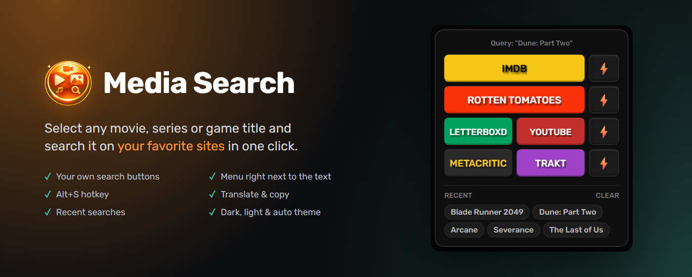
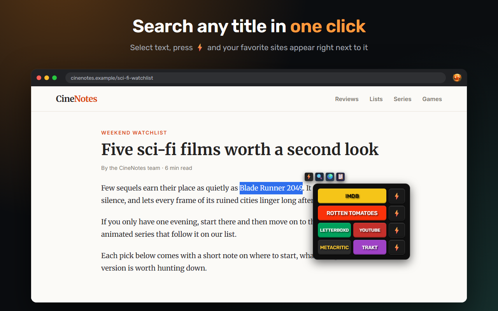
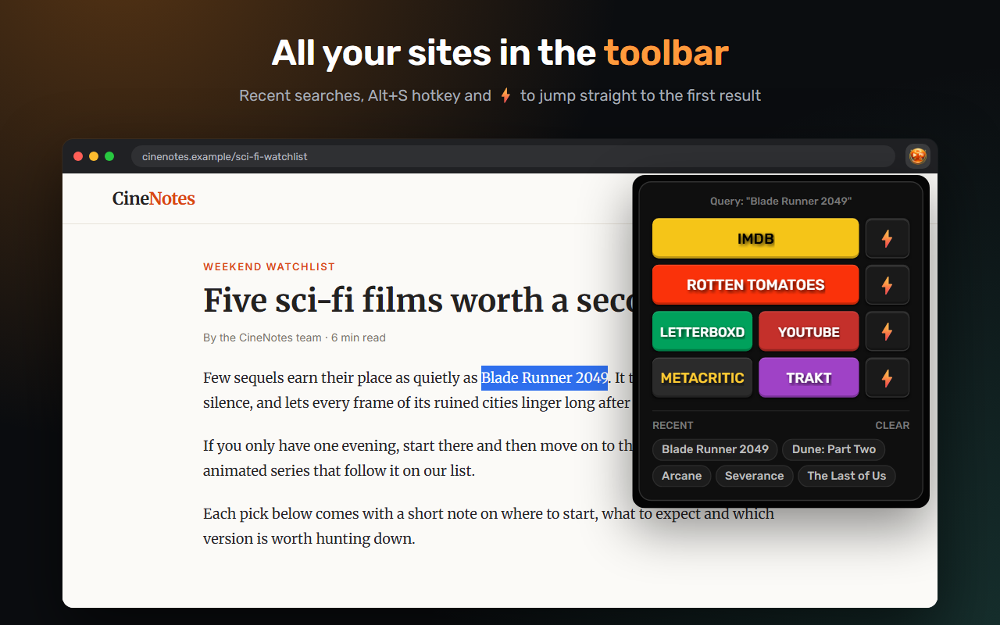
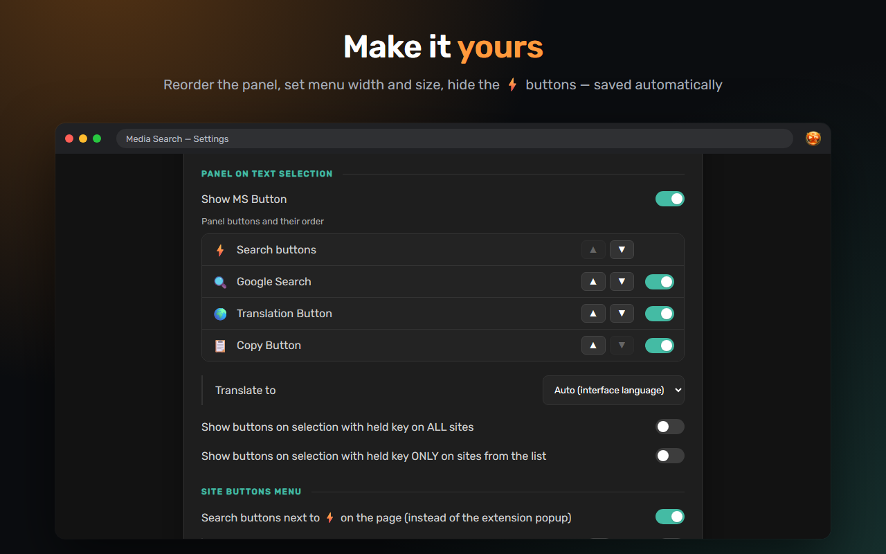
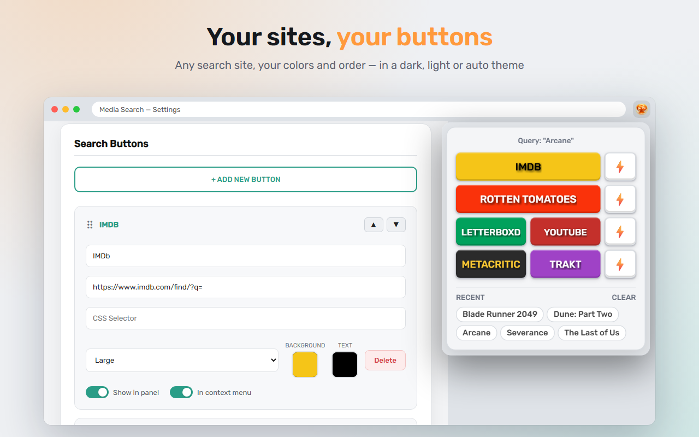
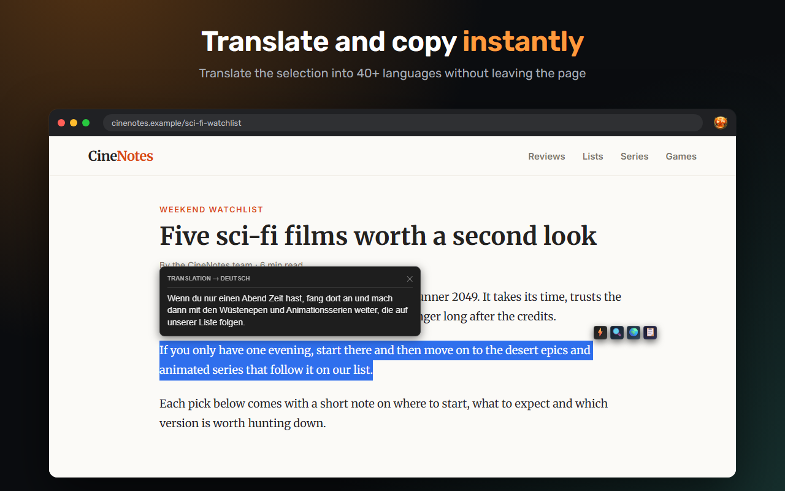

  

  

  <a href="README.md">English</a> · <a href="README.ru.md">Русский</a> · <b>Українська</b>

# Media Search

Розширення для Chrome, яке шукає будь-який фільм, серіал чи гру на ваших улюблених сайтах в один клік.

Виділіть назву на будь-якій сторінці й натисніть ⚡ — ваші кнопки пошуку з'являться просто біля тексту. Ще один клік — і пошук відкриється на IMDb, Rotten Tomatoes, Letterboxd, YouTube або будь-якому іншому сайті, який ви додали.

## Знімки екрана

| | |
|---|---|
|  |  |
| **Пошук в один клік.** Меню відкривається просто біля виділеного тексту. | **Вікно на панелі браузера.** Історія запитів, гаряча клавіша Alt+S і ⚡ для переходу до першого результату. |
|  |  |
| **Під себе.** Порядок кнопок панелі, ширина й розмір меню, приховування кнопок ⚡. | **Ваші сайти — ваші кнопки.** Будь-який сайт пошуку, свої кольори й порядок, темна, світла або авто-тема. |
|  | |
| **Переклад і копіювання.** Переклад виділеного на 40+ мов, не залишаючи сторінку. | |

## Можливості

**Пошук**
- Скільки завгодно власних кнопок пошуку: назва, адреса пошуку, колір фону й тексту, великий або міні-розмір
- Меню пошуку просто біля виділеного тексту або класичне вікно на панелі браузера
- ⚡ біля кожного ряду одразу відкриває перший результат пошуку (необов'язковий CSS-селектор)
- Пошук через контекстне меню
- Гаряча клавіша Alt+S (змінюється в `chrome://extensions/shortcuts`)
- Керування меню з клавіатури: стрілки / Tab — вибір, Enter — відкрити, 1–9 — відкрити кнопку, Esc — закрити

**Панель при виділенні**
- Чотири швидкі кнопки: ⚡ пошук, 🔍 Google, 🌍 переклад, 📋 копіювання
- Можна змінювати їх порядок і вимикати непотрібні
- Переклад на 44 мови або автоматично на мову інтерфейсу
- Показ панелі лише із затиснутою клавішею — на всіх сайтах або тільки на сайтах зі списку

**Вигляд**
- Темна, світла та автоматична тема
- Ширина меню (200–400 px) і розмір (60–100 %)
- Значки сайтів і кнопки ⚡ праворуч — за бажанням
- Довгі назви спочатку зменшуються, і лише потім обрізаються «…»
- Власний шрифт, розмір шрифту кнопок і логотип

**Зручність**
- Історія запитів у вікні розширення (за бажанням, останні 15)
- Кнопку можна приховати, не видаляючи, — окремо для панелі та контекстного меню
- Перетягування для зміни порядку кнопок
- Налаштування зберігаються автоматично
- Резервна копія та відновлення всіх налаштувань
- Інтерфейс 8 мовами: українська, англійська, російська, німецька, французька, іспанська, італійська, польська

## Встановлення

**Chrome Web Store** — знайдіть «Media Search».

**Вручну (режим розробника)**
1. Завантажте останній реліз і розпакуйте його.
2. Відкрийте `chrome://extensions` і ввімкніть **Режим розробника**.
3. Натисніть **Завантажити розпаковане розширення** й виберіть розпаковану папку.

Потрібен Chrome 127 або новіший.

## Як додати сайт пошуку

1. Відкрийте будь-який сайт, знайдіть на ньому будь-яке слово й скопіюйте адресу сторінки результатів.
2. Видаліть це слово з адреси — те, що залишилося, і є **адреса пошуку**, наприклад `https://www.google.com/search?q=`.
   Якщо слово стоїть посередині адреси, поставте на його місце `{searchTerms}`: `https://letterboxd.com/search/{searchTerms}/`.
3. За бажанням: **CSS-селектор** для ⚡ — посилання першого результату, наприклад `a[href*="/film/"]`.

Повна інструкція з прикладами є просто на сторінці налаштувань.

## Конфіденційність

Без акаунтів, стеження та реклами.

- Налаштування й історія запитів зберігаються тільки у вашому браузері (`chrome.storage.local`).
- Виділений текст надсилається лише туди, куди ви самі його надсилаєте: на обраний сайт пошуку або в Google Перекладач, коли ви натискаєте 🌍.
- Значки сайтів беруться з кешу самого Chrome — жодних запитів до зовнішніх сервісів.

## Дозволи

| Дозвіл | Навіщо |
|---|---|
| `contextMenus` | Пункти пошуку в меню правої кнопки миші |
| `scripting`, `activeTab` | Прочитати виділений текст, коли ви відкриваєте вікно розширення або натискаєте гарячу клавішу |
| `storage` | Зберігати ваші кнопки, налаштування та (за бажанням) історію запитів |
| `favicon` | Значки сайтів на кнопках (за бажанням) |
| `translate.googleapis.com` | Переклад виділеного після натискання 🌍 |
| Скрипт на сторінках http/https | Показати панель біля виділеного тексту |

## Список змін

Див. [CHANGELOG.uk.md](CHANGELOG.uk.md).
